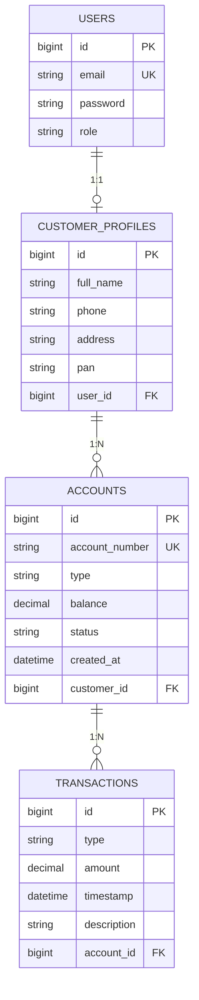

# Banking Management System

A clean, beginner-friendly **Spring Boot + MySQL + Plain HTML/JS** demo banking application built with a classic layered architecture (`Controller -> Service -> Repository`), separate DTOs and Entities, JWT authentication, role-based access (`CUSTOMER` / `ADMIN`), Bean Validation, Global Exception Handling, and Swagger/OpenAPI docs.

---

## Project Structure

```text
com.sprint.bank
├── config        OpenApiConfig, DataSeeder
├── controller    AuthController, AccountController, TransactionController, AdminController
├── service       AuthService, AccountService, TransactionService (+ impl)
├── repository    UserRepository, CustomerProfileRepository, AccountRepository, TransactionRepository
├── entity        User, CustomerProfile, Account, Transaction (+ enums)
├── dto           RegisterRequest, LoginRequest, AuthResponse, CreateAccountRequest, AmountRequest, TransferRequest, UpdateStatusRequest, AccountResponse, TransactionResponse, CustomerResponse
├── security      JwtUtil, JwtFilter, CustomUserDetailsService, SecurityConfig
├── exception     AccountNotFoundException, InsufficientBalanceException, BadRequestException, ErrorResponse, GlobalExceptionHandler
└── BankApplication.java
```

---

## ER Diagram



---

## Prerequisites

- **Java 17+** (verified on JDK 20)
- **Maven 3.8+**
- **MySQL 8.0+** (or use the built-in `h2` profile for zero-setup in-memory testing)

---

## Setup & Running

### Option 1: Run with MySQL (Default)
1. Ensure MySQL is running on `localhost:3306`.
2. Update your MySQL username/password in `src/main/resources/application.properties` (or set `DB_USERNAME` / `DB_PASSWORD` environment variables).
   - Default in properties: `root` / `root`
   - Database `banking_db` is created automatically (`createDatabaseIfNotExist=true`), or you can run `database/schema.sql`.
3. Run the application:
   ```bash
   mvn spring-boot:run
   ```

### Option 2: Run with In-Memory H2 (Quick Demo)
```bash
mvn spring-boot:run -Dspring-boot.run.profiles=h2
```

### Access URLs
- **Web App (Frontend):** http://localhost:8080/
- **Swagger UI:** http://localhost:8080/swagger-ui.html

---

## Demo Seed Accounts

On first startup, `DataSeeder` automatically creates sample users if the database is empty:

| Role | Email | Password | Seeded Account |
|---|---|---|---|
| `ADMIN` | `admin@bank.com` | `admin123` | - |
| `CUSTOMER` | `rahul@bank.com` | `customer123` | `BNK100001` (SAVINGS, 15000.00) |
| `CUSTOMER` | `ananya@bank.com` | `customer123` | `BNK100002` (SAVINGS, 8000.00) |

---

## REST API Endpoints

| Method | Endpoint | Description | Access |
|---|---|---|---|
| `POST` | `/api/auth/register` | Create user + customer profile | Public |
| `POST` | `/api/auth/login` | Login and receive JWT | Public |
| `POST` | `/api/accounts` | Open a new SAVINGS / CURRENT account | Customer |
| `GET` | `/api/accounts` | List logged-in customer's accounts | Customer |
| `POST` | `/api/accounts/{id}/deposit` | Deposit money into account | Customer |
| `POST` | `/api/accounts/{id}/withdraw` | Withdraw money from account | Customer |
| `POST` | `/api/transfers` | Atomic transfer between accounts (`@Transactional`) | Customer |
| `GET` | `/api/accounts/{id}/transactions` | View account statement | Customer |
| `GET` | `/api/admin/customers` | View all customers and their accounts | Admin |
| `GET` | `/api/admin/accounts` | View all accounts | Admin |
| `PUT` | `/api/admin/accounts/{id}/status` | Update status (`ACTIVE` / `FROZEN` / `CLOSED`) | Admin |
| `GET` | `/api/admin/transactions` | Filter transactions by `type` and/or `date` (Java Streams) | Admin |

---

## Running Tests

```bash
mvn test
```

## Postman Collection

Import `postman/Banking_Management_System.postman_collection.json` into Postman to test all endpoints directly.
